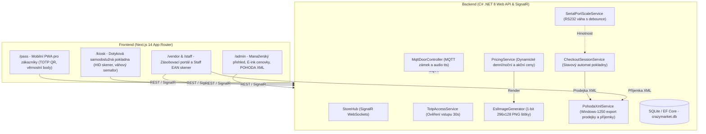

# CrazyMarket 24 – Autonomní bezobslužná prodejna 24/7

Komplexní řídicí a pokladní systém pro bezobslužnou 24/7 retailovou prodejnu postavený na moderních technologiích a **Production-First** architektuře.

---

## 🏗️ Architektura systému

Projekt je navržen tak, aby veškerá komunikace s hardwarem a externími systémy probíhala přes definovaná rozhraní (Interfaces) s produkčními službami odolnými vůči nedostupnosti fyzických zařízení.



---

## 📦 Technologický Stack

- **Backend:**
  - .NET 8 Web API, C# 12
  - Entity Framework Core 8, SQLite (`crazymarket.db`)
  - SignalR (`StoreHub`) pro obousměrný real-time přenos stavu
  - `SixLabors.ImageSharp` – dynamické vykreslování 1-bit E-ink cenovek (296×128 px)
  - `Otp.NET` – časově proměnlivé TOTP tokeny (vstup zákazníka i personálu)
  - `MQTTnet` – integrace řízení dveřního zámku a audio hlášení
  - `System.IO.Ports` – obsluha sériové RS232 váhy
- **Frontend (`src/crazymarket-web`):**
  - Next.js 14 (App Router), TypeScript, Tailwind CSS
  - `@microsoft/signalr` – real-time stav pokladny, vah a cenovek
  - `html5-qrcode` + Web Bluetooth / HID poslech pro čtečky čárových kódů
  - `qrcode.react`, `lucide-react`

---

## 🚀 Moduly a Routy

1. **Zákaznický Pass (`/pass`):**
   - Dynamický TOTP QR kód s 30s odpočtem pro otevření dveří
   - Stav věrnostních bodů (`LoyaltyPoints`) a historie účtenek
   - Simulace pípnutí u dveří a příprava na BankID OIDC
2. **Samoobslužná pokladna (`/kiosk`):**
   - Optimalizováno pro 15.6" dotykový displej
   - Globální poslech USB/HID čtečky čárových kódů (`keydown`)
   - Automatické nebo manuální přiřazení zákazníka
   - Kontrolní váhový semafor bránící odchodu bez zvážení zboží
   - Možnost uplatnění věrnostních bodů na slevu
   - Po zaplacení: tisk/export POHODA prodejky a odemčení výstupních dveří
3. **Zásobovací portál & Staff Skener (`/vendor`, `/staff`):**
   - Řízení přístupu podle rolí (`ExternalVendor`, `InternalStaff`, `Admin`)
   - Vstupní TOTP QR v zásobovacím režimu (15s odemčeno bez váhových alarmů)
   - **Optimalizovaný hromadný závoz:** Přidávání položek na souhrnný dodací list s vystavením **1 souhrnné POHODA XML příjemky** pro celý závoz
   - Nastavení akční ceny před expirací (`ActionPrice`) s okamžitým překreslením E-ink cenovky
   - Kamerový a Bluetooth skener pro rychlé naskladnění zboží
4. **Manažerský panel (`/admin`):**
   - Živý přehled přítomných osob v prodejně (`StoreSession`)
   - Nouzové odemknutí dveří (MQTT) a tárování váhy
   - Celoplošné přepínání denního a nočního tarifu s hromadným překreslením všech E-ink cenovek
   - Přehled exportovaných dokladů pro POHODA ERP

---

## 📋 Vývojové milníky (Sprints)

- **Sprint 1:** Základní .NET 8 Web API, EF Core SQLite model, SignalR `StoreHub`, DB seed (10 produktů, 2 zákazníci).
- **Sprint 2:** Production-First architektura, MQTT dveře, ImageSharp E-ink generátor, Otp.NET TOTP přístup, POHODA XML generátor (`Windows-1250`).
- **Sprint 3:** Pokladní engine (`CheckoutSessionService`), RS232 čtení kontrolní váhy s debounce, dynamická identifikace zákazníka, platba a uplatnění bodů.
- **Sprint 4:** Next.js frontend (`/pass` a `/kiosk`), HID listener, váhový semafor, dev toolbar.
- **Sprint 5:** Role-based zásobování (`ExternalVendor`, `InternalStaff`, `Admin`), mobilní skener, hromadné naskladnění do 1 POHODA příjemky, admin panel (`/admin`).

---

## 🛠️ Spuštění projektu

### 1. Spuštění Backend API
```powershell
cd src/CrazyMarket.Api
dotnet run
```
- API běží na: `http://localhost:5080` (nebo dle `launchSettings.json`)
- Swagger UI: `http://localhost:5080/swagger`

### 2. Spuštění Frontendu
```powershell
cd src/crazymarket-web
npm run dev
```
- Webová aplikace: `http://localhost:3000`
